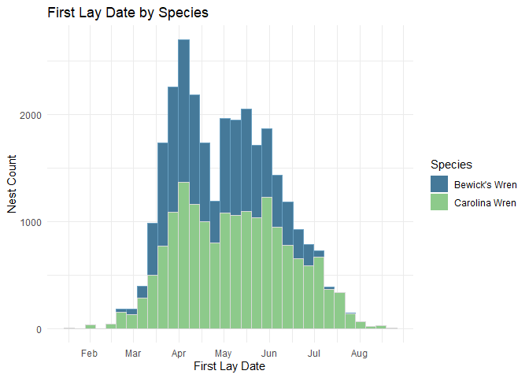

# nestwatchR: Access, Clean, & Process NestWatch Data

<!-- badges: start -->

[](https://www.repostatus.org/#active)
[](https://creativecommons.org/licenses/by-nc/4.0/deed.en)
[](https://www.gnu.org/licenses/gpl-3.0)

<!-- badges: end   -->

## Overview :pushpin:

[NestWatch](http://www.nestwatch.org) is a participatory science project
operated by the [Cornell Lab of Ornithology](https://birds.cornell.edu).
Since 1965, members of the public have been following a standardized
protocol for observing and reporting the nests of birds in the United
States and Canada (and more recently, globally). This data set contains
raw nest records submitted to NestWatch, including millions of nest
check observations from hundreds of thousands of nest attempts
(\>750,000 in 2025). The purpose of this repository is to provide a
collection of functions to aid in accessing and cleaning the wealth of
nesting data contained in the NestWatch database.

**The metadata paper associated with this dataset [(Bailey et
al. 2023)](https://doi.org/10.1002/ecy.4230) is critical for
understanding and interpreting data fields and their contents**. This
dataset is scheduled for updates annually on or about January 31.
Relevant details can also be found on the [NestWatch website
here](https://nestwatch.org/explore/nestwatch-open-dataset-downloads/).
<br> <br>

## Installation :computer:

This package remains under continued development, expanding
functionality to better serve our research audience, and therefor may
have bugs and unexpected issues. If you encounter any unexpected errors
or issues or have suggestions, please report the bug or reach out to the
package maintainer. Presently, the package exists off-CRAN in the public
[`engagement-center/nestwatchR`](https://github.com/engagement-center/nestwatchR)
GitHub repository. To install the package on your local machine, run the
following code:

``` r
if (!requireNamespace("remotes", quietly = TRUE)) {
  install.packages("remotes")
}

# Install nestwatchR package in R
remotes::install_github("engagement-center/nestwatchR")
```

<br> <br>

## Data access :globe_with_meridians:

Data from NestWatch are free to access either from the
[`nw.getdata()`](https://engagement-center.github.io/nestwatchR/reference/nw.getdata.html)
function in R or as a direct download from the [Mendeley Data
Archive](https://data.mendeley.com/datasets/wjf794z7gc). NestWatch Open
Dataset by Cornell Lab of Ornithology is licensed under CC BY-NC 4.0. We
encourage researchers seeking to conduct formal analyses to use these
data. As with any dataset, knowing the data structure, understanding the
metadata, grasping the data collection protocols, and being aware of the
unique aspects of the program are all critical for conducting analyses
and interpreting results in ways that provide meaningful insights. Prior
to analysis, we encourage all users of NestWatch Data to read the
article [“Download Raw NestWatch Data for
Analysis”](https://nestwatch.org/explore/nestwatch-open-dataset-downloads/)
article on our website.

<br> <br>

## Versions :memo:

This package is on Version 1.0.0 and will be updated to maintain
functionality and improve accessibility to the NestWatch datasets. If
you encounter issues while using the package or have suggestions, you
can submit an
[issue](https://github.com/engagement-center/nestwatchR/issues) on
GitHub or [contact us
directly](mailto:kim.savides@cornell.edu?subject=nestwatchR%Issue%%3A).

The NestWatch Open Dataset is updated annually, by or around 31 January,
with the previous year’s nesting records. NestWatch also updates the
database with historical nest records being archived from other
projects. To improve reproducibility in NestWatch analyses, each version
of the dataset is archived in Mendeley, and each specific version can be
downloaded either using the
[`nw.getdata(version = )`](https://engagement-center.github.io/nestwatchR/reference/nw.getdata.html)
function or by a direct download from the [Mendeley
archive](https://data.mendeley.com/datasets/wjf794z7gc/2).

<br> <br>

## Citations :book:

If you use the NestWatch Open Dataset or this R package, please cite:

<blockquote>

**Dataset (replace with appropriate version \# and year):**</br> Bailey,
R. L., L. Larson, D. Bonter. 2026. “NestWatch Open Dataset.” Mendeley
Data, V6. DOI:
[10.17632/wjf794z7gc](https://doi.org/10.17632/wjf794z7gc)</a>

**Data Paper:**</br> Bailey, R. L., L. Larson, and D. N. Bonter. 2024.
“NestWatch: An Open-Access, Long-Term Data Set on Avian Reproductive
Success.” Ecology 105(2): e4230. DOI:
[10.1002/ecy.4230](https://doi.org/10.1002/ecy.4230)</a>

**NestWatch R Package (replace appropriate version \# and year):**<br>
Savides, K., R. L. Bailey, & D. N. Bonter. 2026. NestWatch Data Products
(Version 1.0.0) \[Computer software\].
<https://github.com/engagement-center/2024-NestWatch-Package-Internal>

</blockquote>

<br> <br>

## Vignettes :books:

For full function documentation, including a series of examples covering
introductory usage of NestWatch data, please see the following
Vignettes:

- [Introduction to NestWatch Data and Data
  Access](https://engagement-center.github.io/nestwatchR/articles/a_Intro-and-Data-Access.html):
  covers data access, available data products, definitions of data
  fields, and an introduction to structure and format of data files
- [Conduct Common NestWatch Data Cleaning
  Procedures](https://engagement-center.github.io/nestwatchR/articles/b_Data-Cleaning.html):
  demonstrates how and when to use a variety of common data cleaning
  procedures designed for NestWatch data
- [Estimate NestWatch Summary
  Dates](https://engagement-center.github.io/nestwatchR/articles/c_Data-Estimation.html):
  demonstrates functions to estimate missing summary values
- [Filter NestWatch Data on Finer
  Scales](https://engagement-center.github.io/nestwatchR/articles/d_Data-Filtering.html):
  demonstrates the use of species-level data filters and functions to
  estimate missing values

<br> <br>

## Quick Start :ledger:

This quick start guide shows how to download data and plot the first lay
dates of two species from the NestWatch Open Dataset: Carolina and
Bewick’s wrens. Note that here we force the download of Version 1 of the
NestWatch dataset for reproducibility. When running your own analyses,
you will likely want to download the latest version of the NestWatch
data (see
[`nw.getdata()`](https://engagement-center.github.io/nestwatchR/reference/nw.getdata.html)
for more information).

``` r
# Load NestWatch Package
library(nestwatchR)
library(dplyr)

# Download NestWatch dataset by version
nw.getdata(version = 1)
# nw.getdata()  # no argument will default to downloading the latest version 

# Merge the Attempts and Checks files
nw.mergedata(attempts = NW.attempts, checks = NW.checks, output = "merged.data")
nrow(merged.data)
#>  [1] 2639824

# Filter the dataset to include just Carolina and Bewick's wrens
wrens <- merged.data %>% filter(Species.Code %in% c("carwre", "bewwre"))
nrow(wrens)
#>  [1] 40290
glimpse(wrens)
```

    #> Rows: 40,290
    #> Columns: 54
    #> $ Attempt.ID                                  <chr> "A1000045", "A1000045", "A…
    #> $ Location.ID                                 <chr> "L56654", "L56654", "L1268…
    #> $ Latitude                                    <dbl> 34.68472, 34.68472, 30.614…
    #> $ Longitude                                   <dbl> -98.40583, -98.40583, -98.…
    #> $ Subnational.Code                            <chr> "US-OK", "US-OK", "US-TX",…
    #> $ Species.Name                                <chr> "Carolina Wren", "Carolina…
    #> $ Species.Code                                <chr> "carwre", "carwre", "bewwr…
    #> $ Year                                        <dbl> 2006, 2006, 2006, 2006, 20…
    #> $ Elevation.m                                 <dbl> 344.7000, 344.7000, 316.40…
    #> $ Height.m                                    <dbl> 1.6002, 1.6002, 1.6154, 1.…
    #> $ Substrate                                   <chr> "nesbox", "nesbox", "nesbo…
    #> $ Substrate.Relationship                      <chr> "in", "in", "in", "in", "i…
    #> $ Substrate.Other.Description                 <chr> NA, NA, NA, NA, NA, NA, NA…
    #> $ Predator.Guard                              <chr> NA, NA, "baffle", "baffle"…
    #> $ Predator.Guard.Other                        <chr> NA, NA, NA, NA, NA, NA, NA…
    #> $ Cavity.Entrance.Diameter.cm                 <dbl> 3.810, 3.810, 3.810, 3.810…
    #> $ Entrance.Orientation                        <chr> "ne", "ne", "sw", "sw", "s…
    #> $ Habitat.1m                                  <chr> NA, NA, NA, NA, NA, NA, NA…
    #> $ Habitat.100m                                <chr> NA, NA, NA, NA, NA, NA, NA…
    #> $ Location.Entry.Technique                    <chr> "BIRDHOUSE_HIST:SELF", "BI…
    #> $ Observer.ID                                 <chr> "obsr1309", "obsr1309", "o…
    #> $ First.Lay.Date                              <date> NA, NA, NA, NA, NA, NA, N…
    #> $ First.Lay.Date.Estimated                    <dbl> NA, NA, NA, NA, NA, NA, NA…
    #> $ Visited.During.Egg.Laying                   <dbl> NA, NA, NA, NA, NA, NA, NA…
    #> $ Hatch.Date                                  <date> NA, NA, NA, NA, NA, NA, N…
    #> $ Hatch.Date.Estimated                        <dbl> NA, NA, NA, NA, NA, NA, NA…
    #> $ Fledge.Date                                 <date> NA, NA, NA, NA, NA, NA, N…
    #> $ Fledge.Date.Estimated                       <dbl> NA, NA, NA, NA, NA, NA, NA…
    #> $ Young.Fledged                               <dbl> NA, NA, NA, NA, NA, NA, NA…
    #> $ Clutch.Size                                 <dbl> NA, NA, NA, NA, NA, NA, NA…
    #> $ Young.Total                                 <dbl> NA, NA, NA, NA, NA, NA, NA…
    #> $ Unhatched.Eggs                              <dbl> NA, NA, NA, NA, NA, NA, NA…
    #> $ Outcome                                     <chr> "f", "f", "f6", "f6", "f6"…
    #> $ Attempt.Entry.Technique                     <chr> NA, NA, NA, NA, NA, NA, NA…
    #> $ Visit.ID                                    <chr> "S2489482", "S2489483", "S…
    #> $ Visit.Datetime                              <dttm> 2006-07-10, 2006-08-08, 2…
    #> $ Visit.Time.Valid                            <dbl> 0, 0, 0, 0, 0, 0, 0, 0, 0,…
    #> $ Nest.Status                                 <chr> NA, NA, "in", "cn", NA, NA…
    #> $ Adult.Activity                              <chr> NA, "no", NA, NA, NA, NA, …
    #> $ Young.Status                                <chr> NA, NA, NA, NA, NA, NA, NA…
    #> $ Management.Status                           <chr> NA, "nm", NA, NA, NA, NA, …
    #> $ Host.Eggs.Count                             <dbl> 5, NA, NA, NA, 4, 6, 1, 1,…
    #> $ Host.Eggs.Present.Uncounted                 <dbl> 0, 0, 0, 0, 0, 0, 0, 0, 0,…
    #> $ Live.Host.Young.Count                       <dbl> NA, NA, NA, NA, NA, NA, NA…
    #> $ Live.Host.Young.Present.Uncounted           <dbl> 0, 0, 0, 0, 0, 0, 0, 0, 0,…
    #> $ Dead.Host.Young.Count                       <dbl> NA, NA, NA, NA, NA, NA, NA…
    #> $ Dead.Host.Young.Present.Uncounted           <dbl> 0, 0, 0, 0, 0, 0, 0, 0, 0,…
    #> $ Brood.Parasite.Eggs.Count                   <dbl> NA, NA, NA, NA, NA, NA, NA…
    #> $ Brood.Parasite.Eggs.Present.Uncounted       <dbl> 0, 0, 0, 0, 0, 0, 0, 0, 0,…
    #> $ Brood.Parasite.Live.Young.Count             <dbl> NA, NA, NA, NA, NA, NA, NA…
    #> $ Brood.Parasite.Live.Young.Present.Uncounted <dbl> 0, 0, 0, 0, 0, 0, 0, 0, 0,…
    #> $ Brood.Parasite.Dead.Young.Count             <dbl> NA, NA, NA, NA, NA, NA, NA…
    #> $ Brood.Parasite.Dead.Young.Present.Uncounted <dbl> 0, 0, 0, 0, 0, 0, 0, 0, 0,…
    #> $ Visit.Entry.Technique                       <chr> NA, NA, NA, NA, NA, NA, NA…

``` r
library(ggplot2)

# Format First.Lay.Date as a date
wrens$First.Lay.Date <- as.Date(wrens$First.Lay.Date)

# Filter out NA values of First Lay Date, force all attempt years to 2024 for visualization
data <- wrens %>% filter(!is.na(First.Lay.Date)) %>% 
                  mutate(First.Lay.Date = as.Date(paste0("2024-", format(First.Lay.Date, "%m-%d"))))
  
# Plot the data in ggplot
ggplot(data, aes(x = First.Lay.Date, fill = Species.Name)) +
  geom_histogram(binwidth = 14, color = "grey60") + 
  facet_wrap(~Species.Name, ncol = 2) +  # Two side-by-side plots
  scale_fill_manual(values = c("#8DCA8B", "#457999")) +  # Fill colors
  scale_x_date(                          # Display nice month labels
    breaks = seq(as.Date("2024-02-01"), as.Date("2024-08-01"), by = "month"),
    labels = c("Feb", "Mar", "Apr", "May", "Jun", "Jul", "Aug")) + 
  labs(x = "First Lay Date", y = "Nest Count", fill = "Species:") +
  theme_minimal() +
  theme(legend.position = "bottom",      # Single legend at the bottom
        strip.text = element_blank(),    # Removes facet titles
        panel.spacing = unit(1, "cm"))   # Adds space between facet panels
```



Here we plot two histograms to inspect the distribution of First Lay
Dates between Bewick’s and Carolina Wrens. Note that the NestWatch
dataset continues to grow with each breeding season, so the numbers
shown in the examples on this site will likely be different from what
you see using the most current version of the Open Dataset.
